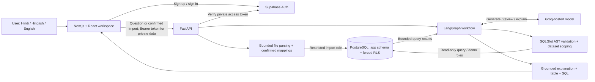
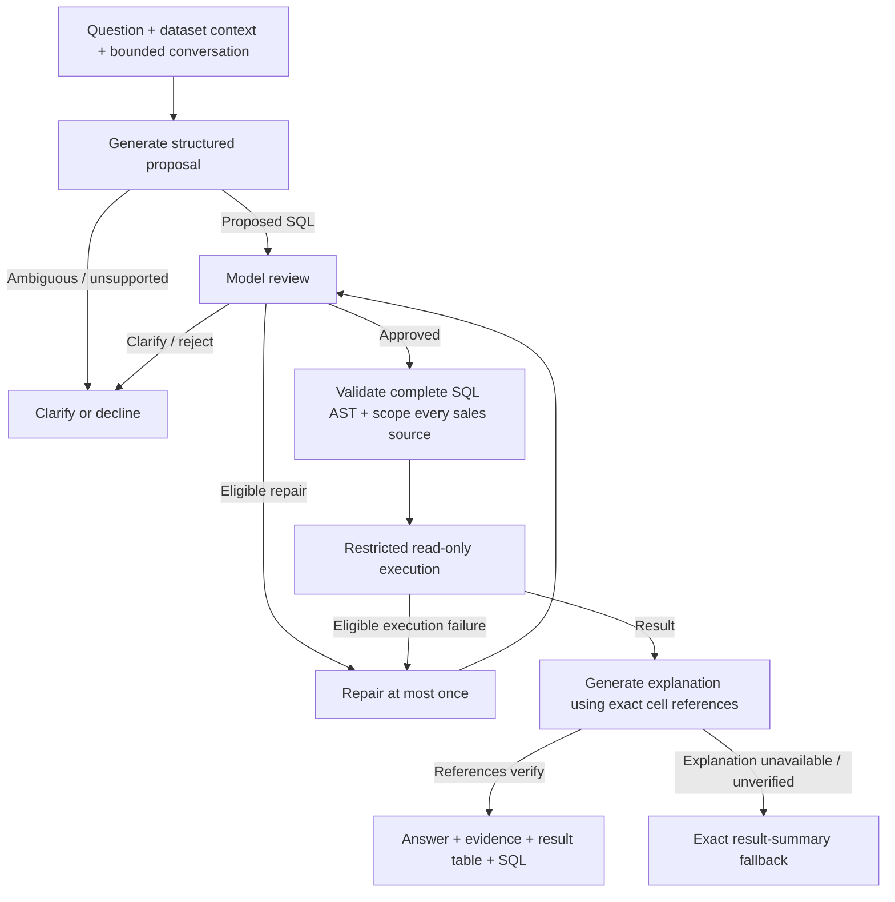
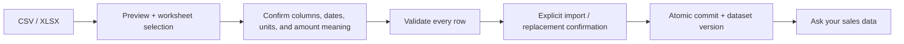

<div align="center">

# HisaabAI

### Apne data se sawaal karo.

Ask sales questions in **Hindi, Hinglish, or English**.<br>
Turn a sales spreadsheet into answers you can inspect, without writing SQL.

[](https://github.com/SHAIKH-AKBAR-ALI/AI-SQL-ANALYST/actions/workflows/checks.yml)


**[Try HisaabAI](https://hisaabai-nine.vercel.app)** · **[Architecture](#architecture)** · **[Run locally](#run-locally)** · **[How answers are checked](#how-answers-are-checked)**

</div>

---

## Why HisaabAI?

The person who needs a sales number should be able to ask for it in the language they use at work. HisaabAI connects everyday questions to structured sales data: upload a CSV or Excel workbook, confirm what its columns mean, and ask a question.

```text
"October 2026 mein total sales kitni hui?"
"अक्टूबर 2026 में कितने लीटर दूध बिका?"
"Show revenue by product in October 2026."
```

The application generates SQL, reviews it, validates its structure, runs a restricted read query, and returns the result with an explanation. You can inspect the SQL, filters, assumptions, and underlying table rather than relying on the explanation alone.

**Current focus:** spreadsheet-based sales analysis for small businesses. The implementation works with a confirmed sales schema; it is not an arbitrary-database connector.

## What you can do

| Capability | Experience |
| --- | --- |
| **Ask in your language** | Use Hindi, Hinglish, or English for sales questions and follow-ups. The agent is instructed to respond in the question's language. |
| **Explore without an account** | Open the fictional, read-only shop demo and use the example questions. |
| **Create a private workspace** | Sign up or sign in with Supabase Auth, then select your own datasets. Signup handles email confirmation when required. |
| **Import deliberately** | Preview CSV/XLSX files, choose a worksheet, map columns, confirm date format and units, validate all rows, then explicitly confirm the import. |
| **See the evidence** | Inspect the result table, generated SQL, assumptions, applied filters, and explanation provenance. |
| **Use charts where they fit** | Supported, complete revenue/count result shapes can produce charts. Other results remain tables. |
| **Continue a conversation** | Ask follow-up questions or answer a clarification. Recent turns provide context; values are queried again. |
| **Keep useful history** | Private question/SQL records and import history persist with the original dataset version. Result rows are not retained in history. |
| **Replace a dataset** | Review the current version and explicitly confirm replacement. Imports are atomic; repeated submissions do not duplicate totals. |
| **Take results with you** | Export result tables as CSV with spreadsheet-formula protection. |

### Try the seeded demo

Open the [live application](https://hisaabai-nine.vercel.app), select **Try Demo**, and ask about **October 2026**. No account is needed for the demo; AI answers require the hosted provider to be available.

The fictional ledger in [supabase/seed.sql](supabase/seed.sql) has six sales rows across September, October, and November. Its October revenue is:

| Product | October 2026 revenue |
| --- | ---: |
| Milk | INR 1,050.00 |
| Potato | INR 240.00 |
| Notebook | INR 150.00 |
| **Total** | **INR 1,440.00** |

An equivalent logical query is:

```sql
SELECT SUM(amount) AS revenue
FROM sales
WHERE sale_date >= '2026-10-01'
  AND sale_date < '2026-11-01';
```

The executor validates and rewrites the allowed `sales` relation to enforce the selected dataset. The model's SQL is not sent directly to the database unchanged.

## Architecture



The browser handles authentication and the workspace UI. The backend owns file validation, access checks, the agent workflow, and database execution. Supabase Auth provides identity; PostgreSQL row-level security enforces private-data isolation. The application tables live in the `app` schema, outside the exposed Data API schemas.

### Technology choices

| Layer | Technology | Purpose |
| --- | --- | --- |
| Interface | Next.js 16, React 19, TypeScript, Tailwind CSS 4 | Demo, authentication, imports, conversations, and result inspection |
| Visualization | Recharts | Charts for supported result shapes |
| API | FastAPI, Pydantic | Typed request contracts and application endpoints |
| Agent orchestration | LangGraph, LangChain Groq integration | Explicit generation, review, execution, explanation, and repair stages |
| Model provider | Groq | Hosted SQL generation, review, and explanation |
| SQL enforcement | SQLGlot | Whole-query AST checks and dataset-scoped rewriting |
| Persistence | PostgreSQL 17, SQLAlchemy, psycopg | Restricted database transactions and normalized sales data |
| Identity | Supabase Auth | Email/password signup, sign-in, and verified private requests |
| Spreadsheet parsing | Python CSV, openpyxl | Deterministic CSV/XLSX inspection and validation |
| Observability | Request telemetry, optional Langfuse | Stage timing and redacted diagnostic metadata |
| Delivery | GitHub Actions, Vercel, Render | Automated verification and deployment configuration |

Exact dependency versions are recorded in [frontend/package.json](frontend/package.json), [backend/requirements.txt](backend/requirements.txt), and the npm lockfiles.

## How answers are checked



The model reviewer is one layer of the workflow. Structural SQL checks and database permissions are enforced independently after review, including on repaired SQL.

- **Bounded agent work:** at most five model calls per request, no SDK retries, and one eligible SQL repair. A repair passes review and SQL validation again.
- **Restricted SQL:** only a defined analytical subset is allowed. Physical sources must resolve to the permitted sales relation; unsupported structures fail closed.
- **Bounded execution:** read-only, consistent snapshots; database statement timeout of five seconds; results capped at 200 rows and 64 KiB, with explicit truncation metadata.
- **Grounded explanations:** the model proposes prose with result-cell references. Verified references are substituted with exact values; an unverified explanation falls back to a deterministic result summary.
- **Clarification before guessing:** missing metrics, ambiguous fields, and unsupported questions can produce clarification or refusal. Empty results are not presented as proof of zero sales.

These controls reduce failure modes; they do not guarantee that every natural-language question will be interpreted correctly. The table, SQL, filters, and assumptions stay available for inspection.

## Import and data model



Required fields are `sale_date`, `product_name`, `quantity`, and `amount`. Units must be mapped or supplied as a confirmed default; `unit_price` and `currency` mappings are optional within the supported import rules. The user confirms that `amount` means final line revenue, including any tax/discount adjustments.

| Table | Responsibility |
| --- | --- |
| `app.datasets` | Ownership, demo/private status, currency, business timezone, and current version |
| `app.sales` | Normalized sale rows scoped to a dataset |
| `app.imports` | Import fingerprints, confirmed mappings, row counts, and dataset versions |
| `app.conversations` | Owner/dataset/version-bound conversations |
| `app.query_runs` | Saved question, SQL, status, clarification, and version metadata |

Schema and access policies are defined in [supabase/migrations/](supabase/migrations/). Dataset replacement is transactional and requires a new conversation. Previous sales versions are not retained.

## Privacy and access boundaries

- Private API requests verify the Bearer token against Supabase Auth. Anonymous Auth accounts are rejected for private access.
- Forced row-level security scopes private datasets, sales, imports, conversations, and history to the verified owner.
- Runtime database connections use separate `hisaab_query`, `hisaab_import`, and `hisaab_demo` roles. The backend rejects unexpected superuser or `BYPASSRLS` runtime roles.
- Private AI requests require explicit consent. The question, confirmed schema context, bounded recent conversation, and query results may be sent to Groq; raw workbook files are not used as AI prompts.
- Raw uploads are not retained as server-side files. Normalized sales, confirmed mappings, fingerprints, and private question metadata are persisted.
- LangSmith tracing is disabled for the agent workflow. Optional Langfuse export contains diagnostic metadata rather than raw questions, SQL, results, or credentials.
- CSV export protects cells that could otherwise be interpreted as spreadsheet formulas.

## Run locally

The commands below use **Windows PowerShell**, matching the repository's development scripts. You need **Python 3.12**, **Node.js 24**, npm, Docker Desktop with Linux containers, and a Groq API key for AI answers.

### 1. Clone and install

```powershell
git clone https://github.com/SHAIKH-AKBAR-ALI/AI-SQL-ANALYST.git
cd AI-SQL-ANALYST

py -3.12 -m venv .venv
.\.venv\Scripts\python.exe -m pip install -r backend/requirements.txt
npm ci
npm ci --prefix frontend

if (!(Test-Path backend/.env)) {
    Copy-Item backend/.env.example backend/.env
}
if (!(Test-Path frontend/.env.local)) {
    Copy-Item frontend/.env.example frontend/.env.local
}
```

### 2. Start the local Supabase stack

Start Docker Desktop, then run:

```powershell
npx supabase start -x realtime,storage-api,imgproxy,mailpit,postgres-meta,studio,edge-runtime,logflare,vector,supavisor
.\.venv\Scripts\python.exe scripts/setup_local.py
```

Supabase starts this project's migrations and seed. The setup script configures the three local restricted database roles and writes their connection settings to ignored environment files. It preserves customized settings and refuses to overwrite conflicting values.

| Local service | Address |
| --- | --- |
| Supabase API / Auth | `http://127.0.0.1:55321` |
| PostgreSQL | `127.0.0.1:55322` |
| Frontend | `http://127.0.0.1:3000` |
| Backend used below | `http://127.0.0.1:8001` |
| Interactive API docs | `http://127.0.0.1:8001/docs` |

### 3. Configure AI

Set the following in `backend/.env`:

```dotenv
GROQ_API_KEY=your_groq_api_key
GROQ_MODEL=openai/gpt-oss-20b
```

The development template defaults to `openai/gpt-oss-120b`; [render.yaml](render.yaml) specifies `openai/gpt-oss-20b`. Choose the intended model explicitly. Only the Groq settings can fall back to a private root `.env` file.

The [backend environment template](backend/.env.example) also lists the restricted database URLs, Supabase URL/public key, CORS origins, and optional tracing settings. [frontend/.env.example](frontend/.env.example) lists the public API and Supabase configuration. Provider keys and database credentials belong in backend configuration, never in `NEXT_PUBLIC_` variables.

### 4. Start the API and frontend

In one terminal:

```powershell
powershell -NoProfile -File scripts/backend.ps1 -Port 8001
```

In a second terminal, from the repository root:

```powershell
$env:NEXT_PUBLIC_API_URL = 'http://127.0.0.1:8001'
npm run dev:frontend
```

Open **http://127.0.0.1:3000**. Use the demo immediately, or create an account for private imports. Confirm your email if prompted by the configured Auth settings. Restart app servers after changing environment values; `NEXT_PUBLIC_` values must also be set before a production frontend build.

Use `Ctrl+C` to stop app servers. `npx supabase stop` stops the local database stack while preserving its data.

## Verification and evaluation

The [checks workflow](.github/workflows/checks.yml) provisions a disposable local Supabase stack in GitHub Actions and runs backend/Auth/database checks, a fixed-fixture benchmark, frontend tests, TypeScript checks, a production build, dependency checks, and database advisors.

For an already configured local checkout:

```powershell
npm run test:backend
npm run test:frontend
npm run typecheck
npm run build
```

Database/Auth integration tests are opt-in locally:

```powershell
$env:PHASE2_INTEGRATION = '1'
npm run test:backend
Remove-Item Env:PHASE2_INTEGRATION
```

The [evaluation corpus](evals/cases.json) contains **40 English, Hindi, and Hinglish cases**, covering expected answers, clarification, unsupported requests, and adversarial prompts. It uses fictional demo, edge, and empty fixtures.

```powershell
# Reference SQL against fixtures; does not invoke the model.
.\.venv\Scripts\python.exe scripts/evaluate_agent.py

# Explicit live model evaluation; consumes Groq quota.
.\.venv\Scripts\python.exe scripts/evaluate_agent.py --live --pause 55
```

Reference-query checks and live model evaluation measure different things. Live results depend on the model, prompt version, provider availability, and quota. No single benchmark score is claimed as universal application accuracy.

## Deployment

- **Frontend:** configured for Vercel. The GitHub Actions deployment job depends on successful verification and runs for `main` when the repository variable `ENABLE_DEPLOYMENTS` is `true`. Deployment credentials are supplied through GitHub configuration.
- **API:** [render.yaml](render.yaml) defines a Render Python service, its environment-variable names, a liveness endpoint, and a single Uvicorn worker.
- **Auth and data:** hosted operation needs a separately configured Supabase project with the migrations and restricted runtime roles provisioned. The local setup script deliberately targets the local stack.
- **Process-local state:** admission limits and demo-session context are in memory. The supplied API configuration uses one worker; multi-worker or multi-instance scaling needs shared coordination.

`GET /health` reports process liveness, not database or model readiness.

## Scope and limitations

| Area | Current boundary |
| --- | --- |
| Input files | UTF-8 comma-separated CSV and unencrypted XLSX; 5 MiB source file, 10,000 rows, 50 columns, up to 10 worksheets |
| Import behavior | All rows must validate before commit; no partial import mode |
| Business data | Confirmed sales fields, INR, Asia/Kolkata timezone, and litre/kg/piece units |
| Metrics | Sales/revenue analysis; cost data is not modeled, so revenue must not be presented as profit |
| SQL | Defined read-only analytical subset over the selected sales dataset |
| Conversations | Up to eight recent context turns, a 16,000-byte context limit, and twenty total turns; dataset replacement starts a new conversation |
| Availability | Hosted AI/provider quotas can produce retryable limits; admission limits are process-local |
| Account lifecycle | Signup, sign-in, and sign-out are implemented; password-reset and account-deletion UI are not |
| Data lifecycle | Old sales versions are not retained; retention/deletion administration needs further work |

## Repository map

```text
AI-SQL-ANALYST/
├── frontend/
│   ├── app/                   # Workspace, auth, imports, chat, result rendering
│   └── tests/                 # Result-shape and CSV-export checks
├── backend/
│   ├── app/
│   │   ├── main.py            # API routes, CORS, and request limits
│   │   ├── agent.py           # LangGraph agent and grounded explanations
│   │   ├── sql_executor.py    # SQL AST enforcement and bounded execution
│   │   ├── import_files.py    # File inspection, mappings, and row validation
│   │   ├── file_jobs.py       # Bounded parsing worker processes
│   │   ├── imports.py         # Atomic import and replacement transactions
│   │   ├── history.py         # Private history and consent-aware questions
│   │   ├── workflow.py        # Conversation context and request execution
│   │   ├── database.py        # Restricted roles and transaction identity
│   │   └── auth.py            # Supabase token verification
│   └── tests/                 # Unit, adversarial, and integration checks
├── supabase/
│   ├── migrations/            # Schema, roles, RLS, and workflow state
│   └── seed.sql               # Fictional demo sales
├── evals/                     # Multilingual cases and fixture comparisons
├── scripts/                   # Local setup, development, and evaluation tools
├── .github/workflows/         # Verification and conditional frontend deployment
└── render.yaml                # Backend hosting configuration
```

## Author

Built by **[Shaikh Akbar Ali](https://github.com/SHAIKH-AKBAR-ALI)**.

Have a sales question this workflow should handle, or found a result that needs investigation? [Open an issue](https://github.com/SHAIKH-AKBAR-ALI/AI-SQL-ANALYST/issues) with a fictional or anonymized example, the question, and the expected result.
